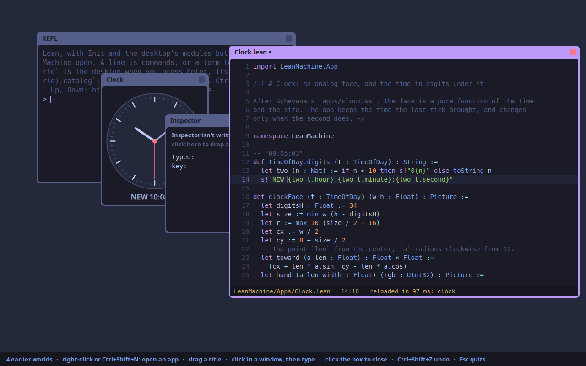

# Lean Machine

Lean Machine is a small desktop environment written in Lean 4.

It started as an experiment: how far can we get building something like
[Schevana](https://github.com/paveluv/Schevana), a Lisp Machine-style
desktop in Chez Scheme, in Lean?

On the Symbolics Lisp Machines, most of the system was written in Lisp.
The idea is similar here: live and work in an environment where everything
you see is written in Lean.

In the 1980s, many home computers booted into a BASIC REPL, and from there
you had full control of the system. That uniform environment, one language
and one system, is the direction Lean Machine is exploring, on a modern
foundation.

## What it has

- a clock
- a Lean REPL, running inside the desktop itself
- a simple editor for the desktop's own Lean files, which can reload an
  app while it runs

The whole desktop is one value that never changes in place, so one undo
takes everything back: windows, definitions made in the REPL, even
reloaded apps.

## Changing a running system

Lisp and Smalltalk were designed to be modified at runtime. This is where
the semantics and design of a language like Lean get challenging and
interesting, and exploring them is one of the aims of this project.

Schevana v0 used simple 2D graphics; v1 went full GPU (shaders written in
Scheme and compiled to GPU code). For now, Lean Machine keeps it simple
with 2D graphics.

## Getting started

So far it's only tested on Ubuntu 26.04.

- [Install and run](docs/install.md)
- [Explore](docs/explore/README.md): small experiments to try
- [Use](docs/use/README.md): the desktop, the REPL, the editor
- [Design](docs/design/README.md): how it's built
- [Ideas](docs/ideas.md): what might come next
